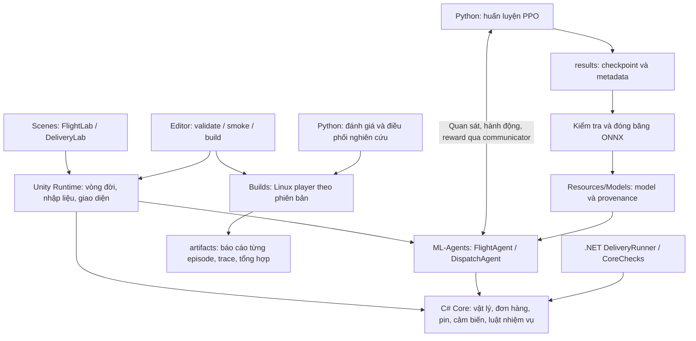

# Kiến trúc dự án AeroLab và cây thư mục

Ngày rà soát: **23/10/2026**. Phạm vi: mã nguồn và cấu hình của `GameBuild-TrainAI`, gồm tính năng chỉnh bố trí/reset đã lưu tại commit `6e87ce6`.

Tài liệu mô tả cấu trúc thực tế của dự án. Các kết quả nghiên cứu được dẫn từ báo cáo đã lưu, không phải kết quả chạy lại trong lượt rà soát này. Phần chỉnh bố trí tương tác và kiểm tra của tính năng được ghi riêng ở mục 13.

## 1. Dự án giải quyết việc gì?

**AeroLab là ứng dụng mô phỏng Unity 3D kết hợp bộ công cụ nghiên cứu AI bằng Python và C#/.NET.** Nhiệm vụ chính là cho một drone giao từng kiện hàng từ kho đến các điểm trong khuôn viên, quay về kho và sạc, dưới ràng buộc pin, tải trọng và hạn giao.

Hai môi trường được giữ trong cùng dự án:

| Môi trường | Nhiệm vụ | Vai trò |
| --- | --- | --- |
| `FlightLab` | Bay từ A đến B, hạ cánh ổn định trong giới hạn 60 giây | Lái tay, bay mẫu và kiểm tra hồi quy nền tảng |
| `DeliveryLab` | Một kho/sạc, bốn điểm giao, một drone, đơn phát sinh theo thời gian | Môi trường giao hàng, huấn luyện và đánh giá hai tầng AI |

Với bộ sinh kịch bản hiện tại, sân phẳng có kích thước 80 × 80 m; stage có vật cản sinh sáu tòa nhà tĩnh. Depot và bốn điểm giao cố định. Stage nhiều đơn sinh 12 đơn trong một phiên 900 giây; tối đa tám đơn ở trạng thái chờ. Mỗi chuyến mang một kiện, giao tại một điểm rồi quay về kho.

Đây là chương trình chạy cục bộ và các tiến trình nghiên cứu đi kèm. Kiến trúc hiện có không triển khai backend web, cơ sở dữ liệu nghiệp vụ hay hệ thống điều khiển drone thật. Dữ liệu thí nghiệm được lưu chủ yếu bằng file JSON, JSONL, checkpoint và ONNX.

## 2. Kiến trúc tổng thể



Trục thiết kế quan trọng nhất là **dùng chung một lõi mô phỏng C#**. Unity hiển thị và kết nối AI với lõi đó; công cụ .NET dùng trực tiếp các file lõi; Python huấn luyện, điều phối, phân tích và lưu thí nghiệm. Python không có một bản vật lý drone riêng để thay thế lõi.

## 3. Ranh giới ba assembly C#

Các file `.asmdef` xác định ranh giới biên dịch và hướng phụ thuộc:

| Assembly | Phụ thuộc khai báo | Trách nhiệm |
| --- | --- | --- |
| `AeroLab.Core` | Không tham chiếu assembly khác; `noEngineReferences: true` | Trạng thái, vật lý, cảm biến, luật giao hàng, lập tuyến và báo cáo |
| `AeroLab.Runtime` | Core, `Unity.ML-Agents`, `Unity.InferenceEngine` | Kết nối lõi với Unity, agent, giao diện và cảnh 3D |
| `AeroLab.Editor` | Core, Runtime, ML-Agents, Inference Engine; chỉ nền tảng Editor | Menu, kiểm tra và build |

Core dùng `System.Numerics.Vector3`; Runtime chuyển đổi sang `UnityEngine.Vector3` khi dựng cảnh. Nhờ đó, `tools/CoreChecks` và `tools/DeliveryRunner` có thể biên dịch trực tiếp `Assets/AeroLab/Core/*.cs` bằng .NET 8 mà không cần UnityEngine.

## 4. Lõi mô phỏng: `Assets/AeroLab/Core/`

| File | Nội dung và vai trò |
| --- | --- |
| `FlightSimulation.cs` | Vị trí, vận tốc, hành động bay, tích phân bước cố định, va chạm, biên sân, hạ cánh, cảm biến và quan sát bay cơ sở |
| `ScenarioConfig.cs` | `OrderSpec`, `SensorConfig`, `ScenarioConfig`, bộ sinh giả ngẫu nhiên theo seed và kiểm tra cấu hình |
| `DeliverySimulation.cs` | Điều phối toàn bộ episode: phát hành đơn, hàng đợi, chọn đơn, pin, giao–quay về, reward, trạng thái kết thúc và quan sát cho hai agent |
| `RoutePlanner.cs` | `RoutePlanner` tìm tuyến tham chiếu và `RoutePilot` tạo lệnh bám tuyến |
| `DemoPilot.cs` | Bộ điều khiển bay mẫu cho sân FlightLab |
| `ClearancePilot.cs` | Bộ điều khiển theo luật dùng làm teacher cho thí nghiệm học bay; có tiên nghiệm độ cao hành trình khoảng 26 m |
| `DeliveryDiagnostics.cs` | Kiểu dữ liệu `LegReport`, `DeliveryTrace` để theo dõi từng chặng và sự kiện |
| `DeliveryReportJson.cs` | Serializer báo cáo dùng chung, xử lý các kiểu dữ liệu lõi mà Unity JsonUtility không biểu diễn đầy đủ |
| `CampusLayout.cs` | Sao chép, đổi ngẫu nhiên, chỉnh và kiểm tra bố trí tòa nhà |

### 4.1. Vật lý và cảm biến

`FlightSimulation` tiến trạng thái theo `Dt = 0.02` giây, tương đương **50 Hz**. Drone có hướng thân cố định và điều khiển bay được hỗ trợ; đây không phải mô hình động lực học rotor chi tiết. Kích thước hull nghiên cứu là 2 × 1 × 2 m.

Va chạm được kiểm tra bằng phép quét hull với hộp AABB. Unity hiển thị trạng thái do lõi tính ra; không dùng thêm Rigidbody/PhysX để tích phân cùng drone. Cảm biến khoảng cách cũng được tính từ hình học lõi, gồm mười hướng đo, không phải ảnh camera.

FlightLab mặc định có giới hạn 3.000 tick, tương đương 60 giây. Chặng bay trong DeliveryLab dùng giới hạn 120 giây. Giới hạn chặng và giới hạn tổng episode là hai khái niệm khác nhau.

### 4.2. Mô hình dữ liệu và vòng đời đơn

- `OrderSpec`: ID, điểm đến, thời điểm phát hành, hạn giao và khối lượng.
- `OrderRecord`: dữ liệu đơn kèm trạng thái thực hiện, thời điểm giao, đúng hạn và lý do thất bại/từ chối.
- `ScenarioConfig`: sân, kho, điểm giao, tòa nhà, đơn, thời lượng, mô hình pin và cấu hình cảm biến.
- `EpisodeReport`: cấu hình, kết quả, chỉ số vận hành, danh sách đơn/chặng và nhận diện model/source.

Luồng trạng thái đơn chính:

```text
Scheduled ──đến thời điểm phát hành──> Pending ──được chọn──> Assigned ──bàn giao──> Delivered
                                       │                       │
                                       ├──không khả thi──> Rejected
                                       └──hết episode───> Unfinished
                                                               └──không giao xong──> Failed
```

Nếu hàng đợi chờ đã đủ tám đơn khi đơn mới xuất hiện, đơn mới bị từ chối với lý do `queue_full`. Đơn quá hạn vẫn có thể giao nhưng không được tính đúng hạn. Nếu đã giao xong rồi chuyến quay về gặp sự cố, trạng thái đã giao vẫn được giữ; sự cố và số lần quay về an toàn được báo cáo riêng.

### 4.3. Máy trạng thái giao hàng

```text
Waiting / Charging
        │ chọn một đơn hợp lệ
        ▼
     Loading ──> Outbound ──> Handover ──> Returning ──> Charging
                      │                         │
                      └──── sự cố / giới hạn ────┴────> Finished
```

`Loading` và `Handover` mỗi giai đoạn có 50 tick chờ, tương đương một giây. Chặng đi và chặng về phải đạt điều kiện hạ cánh ổn định. Lõi cũng kiểm tra drone đã thực sự cất cánh; đến đích hoàn toàn trên mặt đất không được công nhận là chuyến bay hợp lệ.

`DeliveryResult` phân biệt `Completed`, `Horizon`, `Collision`, `OutOfBounds`, `OutOfEnergy`, `FlightTimeout`, `UnsafeReturn`, `NoTakeoff`. `Horizon` nghĩa là hết thời gian episode, không tự đồng nghĩa với đã hoàn thành mọi đơn.

### 4.4. Pin và điều kiện nhận đơn

Cấu hình mặc định: pin đầy 100 đơn vị nghiên cứu, dự trữ 12, sạc tại kho 1 đơn vị/giây và tải tối đa 2 kg.

Năng lượng tiêu hao khi bay:

```text
energy = (0.12 + 0.04 × payload_kg) × dt + 0.008 × distance_m
```

Trước khi chọn đơn, lõi kiểm tra tải và năng lượng dự kiến cho tuyến đi–về kèm dự trữ. Mọi bộ lập lịch đều chịu cùng điều kiện hợp lệ. Ước tính dựa trên tuyến tham chiếu không bảo đảm mọi quỹ đạo do AI tạo ra đều đủ pin. Đây là mô hình năng lượng quy ước, chưa hiệu chuẩn với thiết bị thật.

## 5. Kiến trúc Unity Runtime

### 5.1. DeliveryLab

`DeliveryLab.cs` giữ vai trò điều phối chạy trong Unity:

1. Đọc Mode, seed, stage, nhiễu, model và thư mục báo cáo từ Inspector hoặc tham số dòng lệnh.
2. Tạo `ScenarioConfig` và `DeliverySimulation`.
3. Dựng sân, tòa nhà, kho, điểm giao, drone, camera quan sát và giao diện bằng mã.
4. Khởi tạo FlightAgent và DispatchAgent tùy chế độ.
5. Tiến mô phỏng, cập nhật hiển thị và lưu báo cáo khi kết thúc.

Trong chế độ tham chiếu, `DeliveryLab.FixedUpdate()` gọi luật chọn đơn rồi dùng `RoutePilot`. Trong chế độ có FlightAgent, agent nhận hành động từ trainer hoặc model rồi gọi `Lab.Advance()`; Runtime tránh tiến vật lý thêm một lần trong nhánh tham chiếu.

`DeliveryLayoutControls.cs` là phần thứ hai của `partial class DeliveryLab`. Nó quản lý reset tương tác, đổi bố trí, chỉnh X/Z/chiều cao, lưu/nạp JSON và đánh dấu lượt chạy tương tác. Chi tiết chức năng và kiểm tra nằm ở mục 13.

### 5.2. FlightLab

| Thành phần | Vai trò |
| --- | --- |
| `FlightLab.cs` | Vòng đời lượt bay A–B, lái tay/bay mẫu, pause và reset |
| `FlightWorld.cs` | Dựng sân, vật cản và hình ảnh xe bay |
| `FlightCamera.cs` | Camera toàn cảnh/theo xe, xoay và zoom |
| `FlightHud.cs` | HUD, nút điều khiển, chỉ số và bản đồ |
| `RuntimeSmokeProbe.cs` | Kiểm tra vòng đời runtime cho FlightLab và DeliveryLab |
| `RuntimeLayoutSmokeProbe.cs` | Kiểm tra chỉnh bố trí, lưu/nạp và reset với agent inference |

Camera phục vụ người quan sát. FlightAgent không nhận ảnh camera làm đầu vào.

## 6. Kiến trúc hai tầng AI

### 6.1. Tầng bay: “điều khiển drone thế nào?”

Adapter: `DeliveryFlightAgent.cs`; behavior ML-Agents: `DeliveryFlight`.

| Thuộc tính | Giá trị |
| --- | --- |
| Quan sát | 26 số thực, phiên bản `flight-delivery-1` |
| Hành động | Ba lệnh liên tục trong khoảng [-1, 1] |
| Nhịp quyết định | Mỗi năm tick vật lý, tương đương 0,1 giây |
| Giữa hai quyết định | Giữ hành động; mô phỏng vẫn tiến theo tick 0,02 giây |
| Huấn luyện tăng cường | PPO theo `training/flight.yaml`, có tùy chọn ghi đè trong script |
| Chạy model | ONNX được nạp bằng Unity Inference Engine, inference xác định |

26 quan sát gồm: 20 giá trị bay cơ sở (độ lệch tới đích, vận tốc, độ cao/tiếp đất, mười khoảng cách, thời gian chặng còn lại, tiến độ giữ hạ cánh), rồi pin, tải, cờ quay về, cờ khẩn cấp, thời gian còn đến hạn và cờ mẫu hợp lệ.

Nhiễu giả lập gồm sai số vị trí/độ cao ±0,15 m, khoảng cách ±0,1 m, xác suất mất từng tia 1% và độ trễ năm tick. Tia mất mẫu mang giá trị -1. Quan sát được cache theo tick để đọc lại hoặc vẽ cảm biến không làm phát sinh thêm lượt rút ngẫu nhiên.

### 6.2. Tầng điều phối: “giao đơn nào tiếp theo?”

Adapter: `DeliveryDispatchAgent.cs`; behavior: `DeliveryDispatch`.

| Thuộc tính | Giá trị |
| --- | --- |
| Quan sát | 60 số thực, phiên bản `dispatch-delivery-1` |
| Cấu trúc | Bốn giá trị chung + tám slot × bảy giá trị mỗi đơn |
| Hành động | Một nhánh rời rạc có chín lựa chọn |
| Chín lựa chọn | Chờ/sạc, hoặc chọn một trong tám slot đơn |
| Nhịp quyết định | Mỗi 50 tick, tương đương một giây, khi drone ở kho |
| Huấn luyện | PPO theo `training/dispatch.yaml` |
| Ràng buộc | Action mask loại lựa chọn không đủ điều kiện nhận đơn |

Bốn giá trị chung là tỷ lệ pin, thời gian đã qua, dự trữ và số đơn đã giao. Mỗi slot chứa: có đơn hay không, thời gian còn đến hạn, tuổi đơn, tải, tọa độ đích X/Z và năng lượng cần thiết. Slot được sắp theo thời điểm phát hành rồi ID.

Điều phối không thay đơn khi drone đang thực hiện chuyến. Khi huấn luyện điều phối, model bay được đóng băng; hai tầng không cùng cập nhật trọng số trong bước này.

### 6.3. PPO, EDD, FIFO và A* có vai trò khác nhau

| Thuật toán/bộ điều khiển | Quyết định | Vị trí |
| --- | --- | --- |
| FIFO | Chọn đơn có thời điểm phát hành sớm nhất trong các đơn hợp lệ | `DeliverySimulation.Choose()` |
| EDD / `EarliestDeadline` | Chọn đơn có hạn giao sớm nhất trong các đơn hợp lệ | Cùng hàm `Choose()`; mặc định của DeliveryLab |
| PPO điều phối | Học chọn đơn hoặc chờ/sạc từ 60 quan sát | DispatchAgent + model |
| PPO bay | Học tạo ba lệnh bay từ 26 quan sát | FlightAgent + model |
| A* bốn láng giềng | Tìm đường tham chiếu trên lưới 37 × 37 tại độ cao 16 m, rồi rút gọn các đoạn nhìn thông | `RoutePlanner.Plan()` |
| `RoutePilot` | Bám các waypoint của tuyến tham chiếu | Chế độ tham chiếu |
| `ClearancePilot` | Tạo nhãn hành động theo tiên nghiệm độ cao khoảng 26 m | Teacher cho dữ liệu/học bắt chước và chẩn đoán |

A* không lập thứ tự đơn hàng. Nó phục vụ tuyến tham chiếu, ước tính năng lượng và kiểm tra khả năng trở về. Model bay không nhận toàn bộ bản đồ làm quan sát. Tuy nhiên, điều kiện nhận đơn sử dụng ước tính tuyến dựa trên bản đồ: giới hạn “không camera” không có nghĩa mọi tầng đều chỉ biết dữ liệu cảm biến khoảng cách.

Reward giao đúng hạn là +10, giao trễ +2; còn có tín hiệu tiến độ bay, cất cánh, chi phí thời gian/năng lượng và phạt sự cố. DispatchAgent tích lũy reward từ vòng mô phỏng. Reward là mục tiêu vô hướng gần đúng; không tạo bảo đảm toán học rằng tỷ lệ đúng hạn luôn tối ưu hay mọi ràng buộc an toàn đều được model tự học.

### 6.4. Các chế độ chạy

| Mode | Điều khiển bay | Điều phối |
| --- | --- | --- |
| `reference` | RoutePilot theo tuyến tham chiếu | EDD mặc định hoặc FIFO |
| `flight-demo` | Heuristic tham chiếu, có ghi demonstration | EDD/FIFO |
| `flight` | Agent bay kết nối Python trainer | EDD/FIFO |
| `flight-eval` | Model bay ONNX đã cố định | EDD/FIFO |
| `dispatch` | Model bay ONNX đã cố định | Agent điều phối kết nối Python trainer |
| `dispatch-eval` | Model bay ONNX đã cố định | Model điều phối ONNX đã cố định |

Chế độ huấn luyện yêu cầu kết nối trainer. Mã hiện có không cho phép âm thầm chuyển sang heuristic khi kết nối huấn luyện thất bại. Evaluation yêu cầu model tương ứng.

## 7. Huấn luyện, đánh giá và quản lý bằng chứng

### 7.1. Luồng tạo model

```text
C# tạo mẫu trạng thái + nhãn ClearancePilot
    → pretrain-flight.py: học có giám sát
    → fit-policy-bridge.py: bổ sung trạng thái qua DAgger
    → train-delivery.py: PPO fine-tuning
    → results/<run>: checkpoint, metadata và ONNX
    → freeze-delivery-model.py: kiểm tra ONNX, ghi provenance
    → Assets/AeroLab/Resources/Models/<name>.onnx
    → Unity build mới
    → evaluate-delivery.py: inference trong Linux player
    → artifacts/evaluations/<name>: báo cáo và chỉ số
```

`DeliveryRunner.PolicyBridge` trao đổi observation/action với Python qua JSON Lines, nhưng vẫn tiến vật lý bằng C# dùng chung. Dữ liệu teacher hoặc rollout có trộn teacher dùng để học/chẩn đoán; kết quả nghiệm thu phải lấy từ model đóng băng chạy trong Unity.

Đợt continuity mô tả trong cấu hình hiện tại tiếp tục từ model bay trước đó, bổ sung DAgger cho nhiều đơn có nhiễu rồi fine-tune PPO. Vì vậy mô tả toàn bộ quá trình chỉ bằng “PPO từ đầu” là thiếu phần học có giám sát/DAgger.

### 7.2. Cấu hình nền và cấu hình thực chạy

Hai YAML nền đều đặt mạng hai lớp ẩn, mỗi lớp 128 đơn vị. Flight có batch/buffer nền 256/4096; dispatch là 128/2048. Script có thể thay learning rate, chuẩn hóa, batch, buffer và ngân sách bước.

Ví dụ nghiên cứu dispatch hiện tại dùng batch 32, buffer 128, tổng lịch 32.768 bước với các mốc 2.048, 8.192 và 32.768. Do đó muốn biết một run đã dùng gì phải đọc `results/<run>/run.json` và cấu hình sinh ra, không chỉ đọc YAML gốc.

`train-delivery.py`, `delivery_runs.py` và `delivery_checkpoint_hooks.py` quản lý phiên tối đa hai giờ, lưu checkpoint/snapshot, checksum, khóa một tiến trình ghi và khôi phục. Tiếp tục đúng run dùng `--resume`; khởi tạo thí nghiệm mới từ trọng số cũ dùng `--initialize-from`. Hai thao tác này có ý nghĩa khác nhau.

### 7.3. Bộ nghiên cứu hiện tại

Nguồn cấu hình: [`training/studies/continuity-v2.json`](../training/studies/continuity-v2.json), tag `continuity-v2-r2`.

| Phạm vi seed | Mục đích |
| --- | --- |
| 0–7999 | Pool kịch bản được phép dùng khi huấn luyện; không có nghĩa đã chạy hết 8.000 seed |
| 11, 29, 47 | Ba seed huấn luyện model độc lập |
| 11000–11099 | Validation hiện tại, chọn cấu hình/checkpoint |
| 30000–30099 | Final test hiện tại |
| 20000–20099 | Test lịch sử; đã được xem trong phát triển |

Một số hướng dẫn đời đầu dùng validation 10000 và test 20000. Script đánh giá hiện tại và cấu hình continuity sử dụng dải mới ở bảng trên. `research-v1.json` giữ mô tả thí nghiệm cũ; runner hiện tại mặc định đọc `continuity-v2.json`.

`run-delivery-study.py` cung cấp các action: `status`, `flight-validation`, `dispatch-train`, `dispatch-validation`, `final`, `package`. Nó chặn bước học điều phối nếu tầng bay chưa qua gate. Đánh giá FIFO/EDD/AI điều phối dùng cùng tầng bay và dòng kịch bản để so sánh.

### 7.4. Dữ liệu đầu ra và chỉ số

| Dữ liệu | Nơi lưu | Công dụng |
| --- | --- | --- |
| Checkpoint, optimizer, run metadata | `results/<run>/` | Tiếp tục huấn luyện và nhận diện cấu hình |
| ONNX + `*.provenance.json` | `Assets/AeroLab/Resources/Models/` | Nạp inference, nhận diện trọng số và bằng chứng đi kèm |
| `evaluation.json` | `artifacts/evaluations/<name>/` | Nhận diện build/model/settings của phép đánh giá |
| `episode-*.json` | Cùng thư mục đánh giá hoặc thư mục report phiên | Kết quả từng kịch bản |
| Trace JSONL | Thư mục trace được yêu cầu | Sự kiện, lệnh, trạng thái và quan sát theo tick |
| `summary.json`, `study.json` | `artifacts/evaluations/`, `artifacts/studies/` | Chỉ số và tiến độ nghiên cứu |
| `DeliveryBuildInfo.json` | Resources, sinh khi build | Nhận diện source của build |

Model đã freeze có thể vẫn là ứng viên chưa đánh giá. Có ONNX, provenance hoặc checkpoint không tự chứng minh model đã qua nghiệm thu.

`delivery_metrics.py` tính tỷ lệ đúng hạn trên **tất cả đơn được tạo**, gồm cả đơn chưa giao. Độ trễ và năng lượng trên mỗi đơn giao chỉ có nghĩa khi có đơn đã giao. Chỉ số an toàn nhiều đơn chấp nhận `Completed`/`Horizon` khi có ít nhất một đơn giao và một lần quay về an toàn; nó không khẳng định mọi chuyến đều hoàn tất.

Ngưỡng hiện tại cho logistics trên 100 episode là ít nhất 95 episode vận hành an toàn và không có collision/out-of-bounds/out-of-energy. Đây là tiêu chí riêng của thí nghiệm mô phỏng này.

## 8. Editor, build và phụ thuộc

| Thành phần | Cấu hình được kiểm tra trong repository |
| --- | --- |
| Unity Editor mục tiêu | `6000.6.7f1` trong `ProjectVersion.txt` |
| Unity ML-Agents | Package cục bộ `4.0.0`, manifest trỏ tới `artifacts/packages/com.unity.ml-agents` |
| Unity Inference Engine | Lockfile đang resolve `com.unity.ai.inference` `2.6.1` |
| Python training | Script kiểm tra Python 3.10.12, mlagents/mlagents-envs 1.1.0, torch 2.2.2+cpu |
| Công cụ C# ngoài Unity | Hai project .NET 8 |

Đây là phiên bản khai báo/khóa hoặc được script yêu cầu, không phải kết quả kiểm kê lại toàn bộ executable và package đã cài trong lượt này.

`setup-delivery-ai.sh` chuẩn bị môi trường; `prepare-mlagents.py` kiểm tra archive và tạo package cục bộ có bản vá tương thích Unity. Package sinh ra nằm ngoài Git, nên checkout mới cần setup trước khi Unity import.

`DeliveryBuildTools.Linux()` build với thứ tự scene **DeliveryLab trước, FlightLab sau**. Cần phân biệt với `ProjectSettings/EditorBuildSettings.asset` đang liệt kê FlightLab trước. Thứ tự trong bản Delivery do lời gọi build chỉ định trực tiếp.

Mỗi build Delivery tạo `Builds/DeliveryVersions/<id>/`, rồi cập nhật launcher và `current.json` trong `Builds/Delivery/`. Các run huấn luyện/đánh giá ghim vào bản build cụ thể để việc cập nhật launcher không đổi môi trường giữa chừng.

## 9. Cây thư mục có chú giải

Cây dưới đây lược `.meta`, file Unity mặc định ít liên quan và các lần chạy/model sinh ra lặp lại. Những thư mục ghi “sinh ra” không phải danh sách nguồn cần commit.

```text
GameBuild-TrainAI/
├── AGENTS.md                         # Quy định làm việc và báo cáo thay đổi
├── README.md                         # Giới thiệu, cách mở/chạy và dẫn tài liệu
├── .gitignore                        # Quy tắc loại cache, build, model, kết quả
│
├── Assets/
│   └── AeroLab/
│       ├── Core/                     # C# thuần; không phụ thuộc UnityEngine
│       │   ├── AeroLab.Core.asmdef
│       │   ├── FlightSimulation.cs
│       │   ├── ScenarioConfig.cs
│       │   ├── DeliverySimulation.cs
│       │   ├── RoutePlanner.cs        # Chứa cả RoutePilot
│       │   ├── DemoPilot.cs
│       │   ├── ClearancePilot.cs
│       │   ├── DeliveryDiagnostics.cs
│       │   ├── DeliveryReportJson.cs
│       │   └── CampusLayout.cs        # Sao chép/chỉnh bố trí
│       ├── Runtime/                  # Tích hợp Unity, agent, giao diện
│       │   ├── AeroLab.Runtime.asmdef
│       │   ├── DeliveryLab.cs
│       │   ├── DeliveryLayoutControls.cs # Partial DeliveryLab, chỉnh bố trí
│       │   ├── DeliveryFlightAgent.cs
│       │   ├── DeliveryDispatchAgent.cs
│       │   ├── FlightLab.cs
│       │   ├── FlightWorld.cs
│       │   ├── FlightCamera.cs
│       │   ├── FlightHud.cs
│       │   ├── RuntimeSmokeProbe.cs
│       │   └── RuntimeLayoutSmokeProbe.cs # Smoke bố trí và reset AI
│       ├── Editor/                   # Chỉ chạy trong Unity Editor
│       │   ├── AeroLab.Editor.asmdef
│       │   ├── BuildTools.cs          # FlightLab: mở, validate, smoke, build
│       │   └── DeliveryBuildTools.cs  # DeliveryLab và build Linux theo phiên bản
│       ├── Scenes/
│       │   ├── FlightLab.unity
│       │   └── DeliveryLab.unity
│       └── Resources/
│           ├── FlightSurface.mat
│           ├── Fonts/
│           │   ├── DejaVuSans.ttf
│           │   └── DejaVu-LICENSE.txt
│           ├── Models/               # Sinh ra/ngoài Git: ONNX + provenance + meta
│           │   ├── campus-flight-s{11,29,47}.onnx
│           │   ├── campus-dispatch-s{11,29,47}.onnx
│           │   └── ...               # Các model nghiên cứu và provenance
│           └── DeliveryBuildInfo.json # Sinh khi build; ngoài Git
│
├── Packages/
│   ├── manifest.json                 # Dependency trực tiếp, đường dẫn ML-Agents
│   └── packages-lock.json            # Dependency đã resolve
├── ProjectSettings/
│   ├── ProjectVersion.txt
│   ├── EditorBuildSettings.asset
│   └── ...                           # Player, input, time, graphics, quality...
│
├── training/
│   ├── flight.yaml                   # Cấu hình PPO nền cho tầng bay
│   ├── dispatch.yaml                 # Cấu hình PPO nền cho tầng điều phối
│   ├── requirements-observed.txt     # Python dependency đã ghi nhận
│   └── studies/
│       ├── research-v1.json          # Kế hoạch/thí nghiệm lịch sử
│       └── continuity-v2.json        # Cấu hình mặc định hiện tại
│
├── tools/
│   ├── CoreChecks/                   # Test trực tiếp lõi C# và cấu trúc nguồn
│   │   ├── CoreChecks.csproj
│   │   ├── Program.cs
│   │   ├── DeliveryChecks.cs
│   │   └── NuGet.Config
│   ├── DeliveryRunner/               # Chạy lõi ngoài Unity và bridge dữ liệu
│   │   ├── DeliveryRunner.csproj
│   │   ├── Program.cs
│   │   ├── ControlSamples.cs
│   │   └── PolicyBridge.cs
│   ├── tests/
│   │   └── test_delivery_workflow.py
│   ├── setup-delivery-ai.sh
│   ├── prepare-mlagents.py
│   ├── install-check-tools.sh
│   ├── open-unity.sh
│   ├── check-core.sh
│   ├── check-unity.sh
│   ├── check-delivery-unity.sh
│   ├── train-delivery.py
│   ├── learn-delivery.py
│   ├── pretrain-flight.py
│   ├── fit-policy-bridge.py
│   ├── calibrate-continuous-policy.py
│   ├── flight_feature_policy.py
│   ├── delivery_checkpoint_hooks.py
│   ├── delivery_runs.py
│   ├── restore-delivery-backup.py
│   ├── freeze-delivery-model.py
│   ├── evaluate-delivery.py
│   ├── delivery_metrics.py
│   ├── summarize-delivery.py
│   ├── diagnose-delivery.py
│   ├── run-delivery-study.py
│   ├── fork-delivery-study.py
│   ├── report-delivery-progress.py
│   ├── publish-delivery-build.py
│   ├── delivery-transfer.py
│   ├── check-delivery-portability.py
│   └── worktree-report.py
│
├── docs/
│   ├── project-architecture.md       # Tài liệu đang đọc
│   ├── conversation-2026-10-23.md    # Bản ghi trao đổi theo thời điểm
│   ├── layout-editor.md              # Reset, chỉnh X/Z/chiều cao, lưu/nạp
│   ├── flight-inputs.md              # Đầu vào AI và giới hạn độ cao
│   ├── delivery-lab.md               # Hợp đồng mô phỏng, quan sát và vận hành
│   ├── delivery-continuation.md      # Resume, chuyển máy, nghiên cứu continuity
│   ├── delivery-progress.md          # Báo cáo bằng chứng và kết quả đã lưu
│   ├── delivery-validation.md        # Ghi nhận validation triển khai trước đó
│   ├── v1-spec.md                    # Đặc tả FlightLab đời đầu
│   ├── ai-interface.md               # Giao diện AI FlightLab đời đầu: 20 quan sát
│   ├── step-2-environment-plan.md
│   ├── environment-validation.md
│   └── git-workflow.md
├── notebooks/
│   └── AeroLab-Colab.ipynb           # Chuẩn bị chạy/khôi phục trên Colab
│
├── Builds/                           # Sinh ra, ngoài Git
│   ├── Delivery/
│   │   ├── AeroLabDelivery.x86_64     # Launcher tới một bản build
│   │   └── current.json
│   └── DeliveryVersions/<id>/        # Binary, data, thư viện của từng bản
├── results/<run>/                    # Sinh ra: checkpoint, snapshot, ONNX, log
├── artifacts/                        # Sinh ra: bằng chứng và công cụ cục bộ
│   ├── packages/com.unity.ml-agents/
│   ├── training-configs/
│   ├── datasets/
│   ├── demonstrations/
│   ├── training-episodes/
│   ├── evaluations/<name>/
│   ├── studies/<tag>/
│   ├── diagnostics/
│   ├── transfer/
│   ├── portability/
│   ├── previews/
│   ├── unity-check/
│   ├── tooling/
│   ├── cache/
│   ├── worktree/index.html
│   └── ...                           # Log, báo cáo và archive lịch sử
├── .venv/                            # Môi trường Python cục bộ, ngoài Git
├── Library/                          # Cache import Unity, ngoài Git
├── Logs/                             # Log Unity, ngoài Git
└── UserSettings/                     # Tùy chọn Editor cá nhân, ngoài Git
```

Các file `.meta` vẫn là một phần quan trọng của cây Assets: chúng giữ GUID cho tham chiếu Unity và phải đi cùng tài nguyên. Việc lược chúng trong sơ đồ chỉ nhằm dễ đọc. `.git/` và thư mục thông tin công cụ phiên làm việc cũng được lược vì không phải module ứng dụng.

## 10. Bản đồ công cụ theo mục đích

| Nhóm | File chính | Trách nhiệm |
| --- | --- | --- |
| Chuẩn bị | `setup-delivery-ai.sh`, `prepare-mlagents.py`, `install-check-tools.sh` | Chuẩn bị dependency Python/Unity và SDK kiểm tra |
| Chạy Unity | `open-unity.sh` | Tìm/mở Editor cho checkout |
| Kiểm tra | `check-core.sh`, `check-unity.sh`, `check-delivery-unity.sh` | Kiểm tra lõi, Unity validation, Play Mode và build |
| Học bay ban đầu | `pretrain-flight.py`, `fit-policy-bridge.py` | Học từ nhãn teacher và thu thập thêm trạng thái DAgger |
| Thí nghiệm policy | `calibrate-continuous-policy.py`, `flight_feature_policy.py` | Hiệu chỉnh policy và thí nghiệm giới hạn feature rõ ràng |
| PPO | `train-delivery.py`, `learn-delivery.py` | Tạo cấu hình run, kiểm tra identity rồi gọi ML-Agents trainer |
| Lưu/khôi phục | `delivery_runs.py`, `delivery_checkpoint_hooks.py`, `restore-delivery-backup.py` | Snapshot, checksum, restore và metadata |
| Đưa model vào Unity | `freeze-delivery-model.py` | Kiểm tra shape ONNX 26/60, lưu model và provenance |
| Đánh giá | `evaluate-delivery.py`, `delivery_metrics.py`, `summarize-delivery.py` | Chạy player, resume seed thiếu và tính chỉ số |
| Chẩn đoán | `diagnose-delivery.py` | Chạy checkpoint qua bridge với can thiệp được chỉ định |
| Điều phối nghiên cứu | `run-delivery-study.py`, `fork-delivery-study.py` | Gate, mốc huấn luyện, validation/final; script fork chỉ chuyển tiếp bằng chứng cho bản sửa báo cáo lịch sử đã được chỉ định và kiểm checksum |
| Báo cáo | `report-delivery-progress.py` | Tổng hợp báo cáo từ bằng chứng đã lưu |
| Build/chuyển máy | `publish-delivery-build.py`, `delivery-transfer.py`, `check-delivery-portability.py` | Công bố build cục bộ từ bản kiểm tra, đóng gói và kiểm tra khả năng chuyển môi trường |
| Theo dõi sửa đổi | `worktree-report.py` | Tạo bảng diff HTML, không phải backup hoặc lịch sử nội dung |

## 11. Kiểm chứng được chia thành những tầng nào?

| Tầng | Công cụ/bằng chứng | Chứng minh được |
| --- | --- | --- |
| Core | `tools/CoreChecks`, `bash tools/check-core.sh` | Luật C#, vật lý, trạng thái, cảm biến, tính tái lập; kèm parsing cú pháp và kiểm tra GUID |
| Workflow Python | `tools/tests/test_delivery_workflow.py` | Snapshot/checksum, restore, đóng gói, resume đánh giá và cách tính chỉ số |
| Unity | Editor validate, Play Mode smoke, build | API, tài nguyên và vòng đời chạy Unity |
| AI bay | Frozen ONNX qua `flight-eval` | Kết quả nhiệm vụ bay trong tập kịch bản và cảm biến đã đánh giá |
| Logistics | FIFO/EDD/AI, cùng model bay, qua `run-delivery-study.py` | An toàn vận hành, số đơn giao/đúng hạn, năng lượng, quãng đường và độ trễ |

Qua core không tự chứng minh Unity build thành công. Unity build thành công không tự chứng minh chất lượng model. Tầng bay tốt không tự chứng minh điều phối tối ưu. Mô phỏng không chứng minh vận hành drone thật.

Lượt tổng hợp kiến trúc này chỉ đọc mã/cấu hình và kiểm tra tài liệu; không chạy lại Unity, training hay toàn bộ phép thử nghiên cứu.

## 12. Kết quả đã lưu và giới hạn diễn giải

[`delivery-progress.md`](delivery-progress.md) ghi đợt `continuity-v2-r2` đã hoàn thành 24 điều kiện final × 100 episode: 600 episode một đơn và 1.800 episode nhiều đơn. Trong bảng nhiều đơn, AI điều phối đạt 39,00% đúng hạn ở ideal và 38,72% ở noisy; FIFO tương ứng 17,28% và 17,00%. AI điều phối giao ít đơn hơn tổng thể. Các tỷ lệ này lấy từ báo cáo đã lưu, không phải phép đo mới ở working tree đang chỉnh sửa.

Các giới hạn gắn trực tiếp với kiến trúc:

- Một drone, một kiện/chuyến, một kho và bốn điểm đến; chưa có phân công nhiều drone hoặc gom nhiều kiện trong một tour.
- Nền phẳng, nhà tĩnh sinh theo một bộ quy tắc giới hạn; không có địa hình đồi dốc hay vật cản động trong thí nghiệm này.
- Teacher dùng tiên nghiệm bay cao hơn giới hạn nhà dưới 24 m; kết quả không chứng minh model đã học tránh vật cản bất kỳ từ tia đo.
- Vật lý và năng lượng đơn giản hóa; tải ảnh hưởng tiêu hao nhưng không mô phỏng đầy đủ thay đổi động lực học.
- Một episode nhiều đơn đạt gate vẫn có thể còn đơn chưa xong hoặc chuyến cuối đang bay tại mốc 900 giây.
- Model và kết quả sinh ra bị loại khỏi Git; chỉ sao chép source chưa đủ tái tạo ngay toàn bộ bằng chứng hoặc model.

## 13. Chỉnh bố trí tòa nhà và reset tương tác

Tính năng đã được triển khai tại commit `6e87ce6`; tác vụ tổng hợp kiến trúc chỉ mô tả và dẫn bằng chứng của phần triển khai:

- `CampusLayout.cs`: tạo bản sao cấu hình, đổi/chỉnh bố trí và kiểm tra giới hạn hình học.
- `ScenarioConfig.cs`: thêm `LayoutSeed`, `LayoutOrigin`, tăng environment version thành `delivery-v3`.
- `DeliveryLayoutControls.cs` và `DeliveryLab.cs`: chia partial class, UI chỉnh nhà, giữ bố trí khi reset, lưu/nạp tại `artifacts/layouts/campus.json`.
- Hai agent: tránh tự đổi episode/seed trong reset tương tác.
- `EpisodeReport`: thêm `RunPurpose`; Runtime phân biệt `interactive`, `training`, `evaluation`.
- `RuntimeLayoutSmokeProbe.cs`, `DeliveryBuildTools.cs`, `check-delivery-unity.sh` và `DeliveryChecks.cs`: bổ sung kiểm tra core và Play Mode cho bố trí; script Unity có thêm action `layout-smoke`.

Ý định trong mã là chỉnh một bản sao rồi reset episode, thay vì sửa hình học ngay giữa chuyến bay. Chế độ tương tác chỉ được bật với reference/flight-eval/dispatch-eval khi không yêu cầu một batch đánh giá; training không dùng luồng chỉnh này. Test Editor có cơ chế bật tương tác batch riêng. File bố trí chỉ lưu hình học và metadata bố trí, không phải snapshot đầy đủ trạng thái lượt bay.

Bằng chứng tính năng ghi tại [layout-editor.md](layout-editor.md): 35 kiểm thử core, Play Mode với hai model, bản Linux và một lượt batch hồi quy đã đạt. Lượt batch giữ nguyên kết quả vật lý/nghiệp vụ so với cùng seed của bản nghiên cứu, ngoài metadata bổ sung. Đây là kiểm tra tính năng, không phải nghiệm thu lại AI trên các bố trí tự chỉnh, nhất là nhà cao hơn giới hạn dữ liệu huấn luyện. Xem [flight-inputs.md](flight-inputs.md) để hiểu đầu vào và thiên hướng độ cao của model.

## 14. Đọc hoặc sửa ở đâu theo nhu cầu?

| Nhu cầu | Điểm bắt đầu |
| --- | --- |
| Hiểu một lượt giao hàng | `DeliverySimulation.cs` → `DeliveryLab.cs` |
| Đổi cách chọn đơn | `Choose()`, `ObserveDispatch()`, `Dispatch()` và `DeliveryDispatchAgent.cs` |
| Đổi vật lý/cảm biến | `FlightSimulation.cs`, `ObserveFlight()`, `SensorConfig` |
| Đổi luật pin/tải/hạn giao | `ScenarioConfig.cs`, `RequiredEnergy()`, `Step()` |
| Đổi giao diện DeliveryLab | `DeliveryLab.cs`, phần mở rộng `DeliveryLayoutControls.cs` |
| Đổi tuyến tham chiếu | `RoutePlanner.cs`; phân biệt với teacher `ClearancePilot.cs` |
| Đổi thuật toán/cấu hình học | YAML, `train-delivery.py`, run identity và study JSON |
| Hiểu kết quả model | `delivery-progress.md`, provenance, evaluation manifest và báo cáo từng episode |
| Tiếp tục hoặc chuyển máy | `delivery-continuation.md`, `delivery-transfer.py`, snapshot run |

Các điểm vào kiến trúc quan trọng nhất là **ScenarioConfig → DeliverySimulation → DeliveryLab → hai Agent → công cụ training/evaluation**. Hướng đọc này nối được dữ liệu kịch bản, luật nhiệm vụ, vòng đời Unity, quyết định AI và bằng chứng đầu ra.
